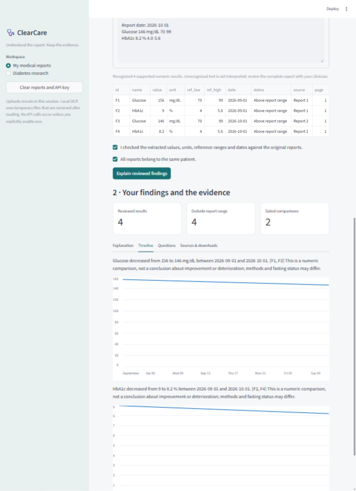

# T1DiabetesGranada

Longitudinal diabetes research and **ClearCare**, a local medical report assistant.

This project studies whether a compact representation of recent glucose history can support forecasting over a longer horizon. It brings together data preparation, VAE representation learning, generative-model experiments, and a small application for exploring the results. The report assistant is a separate workflow: it extracts documented findings and presents explanations with source links.

[Setup](#setup) · [Research models](#research-models) · [Model card](docs/models/CGM_MODEL_CARD.md) · [Audit](docs/reports/RESEARCH_AUDIT_2026-10-19.md) · [Data access](DATA_ACCESS.md)

## Report assistant

ClearCare accepts PDF, image, scanned PDF, and text reports. The user reviews extracted values, units, dates, diagnoses, and medication mentions before generating an explanation. Multiple dated reports can be combined into a timeline, with source locations retained for each finding.

Explanations use a small local collection of medical-source passages. Optional LLM composition orders approved claims and citations; it does not supply missing measurements. A single lab report is enough for a snapshot, but it cannot provide the sensor history needed for forecasting.



*Report review using fictional laboratory values, from an earlier local build.*

## Setup

Run these commands from `projects/granada_t1d` in a separate Python environment:

```bash
python -m venv .venv
source .venv/bin/activate
python -m pip install -r requirements/app.txt
python -m streamlit run app.py
```

Open [localhost:8501](http://localhost:8501). On Windows, use `.venv\Scripts\activate` to activate the environment.

Text-based PDF and text reports use the core dependencies. Images and scanned PDFs also need a supported local OCR backend. Environment configuration, OCR setup, and deployment details are in [Run and deploy](docs/RUN_AND_DEPLOY.md). The existing checks used Python 3.13; a clean installation on every platform has not been verified.

For command-line report export:

```bash
python end_to_end_pipeline.py --report path/to/report.pdf --outdir new_report_output
```

The CLI marks extraction as unreviewed. Check it against the source report before using the explanation.

## Research models

### CGM-only release

The corrected release uses measured CGM readings, without laboratory imputation or diagnosis flags. It builds four daily metrics: mean glucose, time in range, time below range, and coefficient of variation.

A GRU VAE encodes a **30-day history** into a 16-dimensional representation. A separate forecaster predicts **60 daily metric vectors**. Correlated residual simulations and marginal conformal intervals are fitted separately from the point model. Time above range and GMI are derived from the modeled metrics; GMI is not measured HbA1c.

The data split contains 187 training, 47 validation, 39 calibration, and 39 test patients. The groups are disjoint and normalization uses training patients only. Calibration and test evaluation use one window per patient.

**Held-out glucose MAE:**

- Last observed day: 32.16 mg/dL.
- Past seven-day mean: 25.53 mg/dL.
- Past 30-day mean: 23.33 mg/dL.
- VAE/GRU: 23.97 mg/dL.

The neural model was selected on validation data but did not beat the 30-day mean baseline on test glucose error. Nominal-80% marginal interval coverage was approximately 77–79% across the four targets. The [model card](docs/models/CGM_MODEL_CARD.md) gives the full results and limitations; [saved aggregate metadata](docs/models/results/release_001_metrics.json) is included in this repository.

### Earlier multimodal experiments

Phases 1–4 contain the original daily CGM/lab/diagnosis preparation, a two-branch VAE, a conditional tabular GAN, and trajectory-model comparisons. They are retained as earlier experiments. The saved multimodal data contains whole-cohort imputation leakage, and some training/evaluation paths do not match the saved checkpoints. The [audit](docs/reports/RESEARCH_AUDIT_2026-10-19.md) explains the corrections needed before these experiments can support publication.

## Running a glucose simulation

Research dependencies and authorized local artifacts are required:

```bash
python -m pip install -r requirements/research.txt
python end_to_end_pipeline.py --cgm path/to/measured_cgm.csv --simulations 20 --outdir new_cgm_output
```

The input is a single person's CSV with exactly `timestamp,glucose_mg_dl`. The corrected route needs 30 consecutive days, each with at least 64 occupied 15-minute bins. No missing reading is interpolated. Conflicting timestamps or insufficient coverage withhold simulation.

Private model files are not bundled with this public checkout. Follow [data and artifact access](DATA_ACCESS.md) before running model workflows. The Streamlit app also provides the measured-CGM route under **My glucose simulation**.

## Code layout

```text
Phase_1_Data_Preparation/       Source data, curation and legacy daily features
Phase_2_Latent_VAE/             Legacy VAE and window preparation
Phase_3_Generative_Forecasting/ GANs, forecasts and comparisons
Phase_4_RAG_Support/            Research retrieval and report generation
Phase_5_Application/            App, CLI and corrected-release training
src/healthcare_app/             Shared extraction, retrieval and inference code
tests/                         Regression and integration tests
scripts/                       Phase launchers and read-only audit tools
docs/                          Model cards, research notes and audit results
```

The root `app.py` and `end_to_end_pipeline.py` are launchers. See [project structure](docs/PROJECT_STRUCTURE.md) for entrypoints and [audit commands](scripts/AUDITING.md) to reproduce the saved-data checks.

## Verification

With the research stack and authorized local artifacts available:

```bash
python -m pip install -r requirements/dev.txt
python -m pytest tests -q
```

The relocated project passed **130 tests** on 19 October 2026. A separate audit reproduced every retained corrected daily aggregate from all 22,671,708 raw readings, verified disjoint patient groups and train-only scaling, and recomputed checkpoint metrics. Software checks do not establish clinical validity.

## Publication status

The historical IEEE manuscript needs to be rewritten around the exact experiment being reported. Its old architecture, cohort counts, and clinical claims do not match the corrected release. [Research audit](docs/reports/RESEARCH_AUDIT_2026-10-19.md) lists the confirmed issues and [IEEE readiness](docs/IEEE_READINESS.md) points to the publication work remaining.

The dataset is regional, the evaluation cohort is small, and external validation has not been performed. Predictions and generated paths are research outputs, not treatment recommendations.

## Dataset

T1DiabetesGranada contains longitudinal type 1 diabetes records from San Cecilio University Hospital in Granada, Spain. Data access requires permission under the source agreement. Raw records, prepared patient tables, latent exports, weights, and case reports are kept outside Git.

See the [dataset paper](https://www.nature.com/articles/s41597-023-02737-4) and [local data layout](DATA_ACCESS.md).
