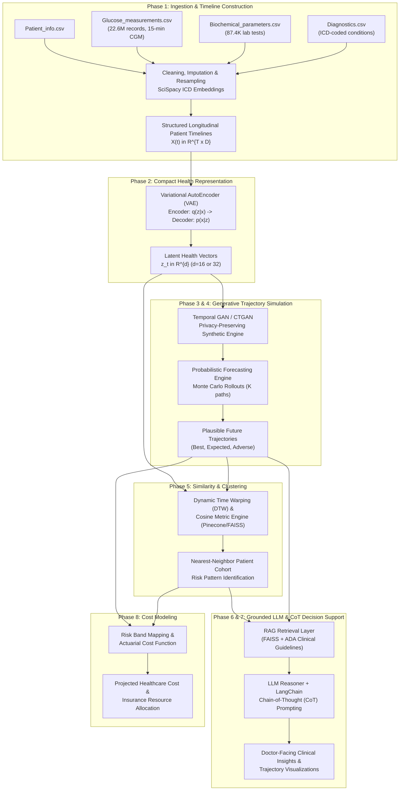

# 8-Phase BTP System Architecture: T1DiabetesGranada
**Project Title**: Longitudinal Generative Health Modeling, Trajectory Forecasting, and Clinical Decision Support in Type 1 Diabetes

---

## 1. System Architecture Overview

---

## 2. Phase-by-Phase Technical Mapping to `T1DiabetesGranada`

### Phase 1: Data Collection & Patient Record Ingestion

* **Dataset Files Used**:
  - `Glucose_measurements.csv` (Continuous Blood Glucose Level at 15-min intervals)
  - `Biochemical_parameters.csv` (17 laboratory biomarkers)
  - `Diagnostics.csv` (ICD codes and text descriptions)
  - `Patient_info.csv` (Static demographic metadata)
* **Concrete Steps**:
  1. **Temporal Binning & Resampling**:
     - Raw CGM measurements occur every 15 minutes (96 points/day). Aggregate glucose readings into standardized time windows (e.g., 1-hour or 4-hour windows) computing: Mean, Standard Deviation, Time in Range ($70-180\text{ mg/dL}$), Time Below Range ($<70\text{ mg/dL}$), and Time Above Range ($>180\text{ mg/dL}$).
  2. **Biochemical Parameter Synchronization**:
     - Lab tests (HbA1c, Creatinine, Lipid panel) occur sporadically (every 3–6 months). Use forward-fill or Gaussian process imputation up to a clinically valid threshold (e.g., 90 days).
  3. **NLP on Diagnostic Text (`SciSpacy`)**:
     - Extract medical concepts from `Diagnostics.csv` (e.g., `"Unspecified essential hypertension"`, `"Diabetes with ophthalmic manifestations"`).
     - Run `en_core_sci_sm` or `en_core_sci_md` from SciSpacy to map descriptions to UMLS (Unified Medical Language System) concept IDs and generate diagnostic embedding vectors $v_{\text{diag}} \in \mathbb{R}^{e}$.
  4. **Output Matrix**:
     - For each patient $i$, build a sequential multi-variate time-series tensor $X_i \in \mathbb{R}^{T \times F}$, where $T$ is time steps and $F$ is feature dimensionality (CGM metrics + Lab values + Static demographics + Diagnostic embeddings).

---

### Phase 2: Compact Representation of Patient Health (AutoEncoders / VAEs)

* **Objective**: Compress sparse, noisy, multi-modal clinical history into a dense, smooth latent health space $\mathbf{z}_t \in \mathbb{R}^d$ ($d=16$ or $32$).
* **Model Architecture**:
  - **Encoder $q_\phi(\mathbf{z}|\mathbf{x})$**: Bidirectional LSTM or 1D-CNN that reads the multi-modal window $\mathbf{x}_{t-W:t}$ and outputs mean $\boldsymbol{\mu}_t$ and log-variance $\log \boldsymbol{\sigma}_t^2$.
  - **Reparameterization Trick**: $\mathbf{z}_t = \boldsymbol{\mu}_t + \boldsymbol{\epsilon} \odot \boldsymbol{\sigma}_t$ where $\boldsymbol{\epsilon} \sim \mathcal{N}(0, \mathbf{I})$.
  - **Decoder $p_\theta(\mathbf{x}|\mathbf{z})$**: Reconstructs the multi-variate clinical sequence $\hat{\mathbf{x}}_{t-W:t}$.
* **Loss Function**:
  $$\mathcal{L}_{\text{VAE}} = \mathbb{E}_{q_\phi(\mathbf{z}|\mathbf{x})}\left[\log p_\theta(\mathbf{x}|\mathbf{z})\right] - \beta \cdot D_{\text{KL}}\left(q_\phi(\mathbf{z}|\mathbf{x}) \,\|\, \mathcal{N}(0, \mathbf{I})\right)$$
* **Why this matters for your BTP**: The raw data is too high-dimensional (22.6M points). The latent vector $\mathbf{z}_t$ acts as a **"Digital Biomarker"** encoding the patient's real-time metabolic and physiological state.

---

### Phase 3: Privacy-Preserving Synthetic Patient Trajectory Simulation (GANs / CTGAN)

* **Objective**: Overcome privacy restrictions (HIPAA/GDPR) and address data scarcity by generating realistic synthetic patient trajectories.
* **Approach**:
  - **Conditional Tabular GAN (CTGAN) / TimeGAN**:
    - Generates synthetic sequences of latent vectors $\hat{\mathbf{z}}_{1:T}$ conditioned on patient demographics (Sex, Age, Baseline HbA1c).
  - **Generator $G$**: Takes random noise $\mathbf{w} \sim \mathcal{N}(0, \mathbf{I})$ and condition $c$ to output synthetic health sequences.
  - **Discriminator $D$**: Distinguishes real latent patient sequences $\mathbf{z}_{1:T}$ from synthetic ones $\hat{\mathbf{z}}_{1:T}$.
* **Validation**:
  - Compare synthetic distributions vs. real data via **Wasserstein Distance** and **t-SNE/UMAP projection**.

---

### Phase 4: Probabilistic Forecasting & Monte Carlo Rollouts

* **Objective**: Predict not just one deterministic future, but a distribution of plausible future health states.
* **Mechanism**:
  - Given a patient's current latent state $\mathbf{z}_t$, autoregressively generate future transitions $\mathbf{z}_{t+1}, \mathbf{z}_{t+2}, \dots, \mathbf{z}_{t+H}$ using a stochastic transition model (e.g., Deep State Space Model or Recurrent VAE).
  - Perform **$K$ Monte Carlo rollouts** (e.g., $K=100$ forward simulation paths per patient).
* **Clinical Interpretation of Paths**:
  - **5th percentile trajectory**: Favorable trajectory (tight glycemic control, low variability).
  - **50th percentile (Median)**: Expected path under current lifestyle/treatment.
  - **95th percentile trajectory**: High-risk adverse trajectory (frequent severe hypoglycemia episodes or persistent hyperglycemic toxicity).

---

### Phase 5: Similarity & Clustering-Based Risk Reasoning

* **Objective**: "Has a patient like this been seen before, and what happened to them?"
* **Techniques**:
  1. **Dynamic Time Warping (DTW)**: Compares non-linear time-series glucose curves invariant to slight phase shifts (e.g., meal delays).
  2. **Cosine / Euclidean Similarity on Latent Vectors $\mathbf{z}$**: Index all historical patient states in **Pinecone** or **FAISS**.
  3. **Nearest-Neighbor Cohort Matching**:
     - Query patient $P_{\text{query}}$ at time $t$. Retrieve the $k=10$ nearest historical patient trajectories.
     - Inspect the retrieved cohort's eventual outcomes from `Diagnostics.csv` (e.g., did 8 out of 10 develop diabetic neuropathy within 24 months?).
  4. **Output**: Empirical risk probabilities calculated from matching patient histories.

---

### Phase 6: RAG + Vector Embeddings + Medical Grounding

* **Objective**: Prevent Large Language Model (LLM) hallucinations by grounding generation strictly in retrieved patient facts and clinical evidence.
* **Architecture**:
  - **Knowledge Corpus**:
    - Clinical Practice Guidelines (e.g., American Diabetes Association Standards of Care).
    - Hospital protocol documents for T1D management.
  - **Vector DB (FAISS)**:
    - Stores embedded medical guidelines + historical cohort case studies.
  - **Retriever**:
    - Input: Query constructed from patient's current metrics (TIR%, HbA1c, GMI, detected risk pattern from Phase 5).
    - Fetches top-$k$ relevant guideline paragraphs and matched cohort statistics.

---

### Phase 7: Chain-of-Thought (CoT) Reasoning & Doctor-Facing Insights

* **Objective**: Produce transparent, explainable, doctor-oriented clinical decision support reports.
* **Agent Framework**: LangChain / LangGraph with step-by-step CoT reasoning:
  - *Step 1 (Observation)*: Summarize current metrics ($TIR=52\%$, Nocturnal hypoglycemia incidence $=14\%$, HbA1c $=8.4\%$).
  - *Step 2 (Cohort Comparison)*: Reference the 10 nearest historical patients from Phase 5.
  - *Step 3 (Guideline Lookup)*: Apply retrieved ADA guideline rules for nocturnal hypoglycemia.
  - *Step 4 (Synthesis & Recommendation)*: Suggest specific clinician actions (e.g., consider adjusting bedtime basal insulin or continuous basal rate; schedule microalbuminuria screening).
* **Visualization Layer**: Interactive graphs comparing historical sensor readings against the $K$ Monte Carlo future forecast cones.

---

### Phase 8: Risk Band Mapping & Healthcare Cost Estimation

* **Objective**: Translate medical risk trajectories into projected economic and insurance costs.
* **Methodology**:
  1. **Risk Band Stratification**:
     - **Band 1 (Controlled)**: TIR $>70\%$, no microvascular complications.
     - **Band 2 (Moderate Risk)**: TIR $50-70\%$, frequent excursions, borderline nephropathy/hypertension.
     - **Band 3 (Severe / Critical)**: Severe hypo events ($<54\text{ mg/dL}$), multiple comorbidities (retinopathy, kidney impairment).
  2. **Actuarial Cost Modeling**:
     $$\text{Estimated Annual Cost} = C_{\text{baseline}} + \sum_{m \in \text{Complications}} P(m \mid \text{Trajectory}) \times \text{Cost}(m) + N_{\text{hypo}} \times \text{Cost}_{\text{ER}}$$
  3. **Value Proposition**: Empowers hospitals and insurance providers to plan preventative interventions before costly emergency hospitalizations occur.
