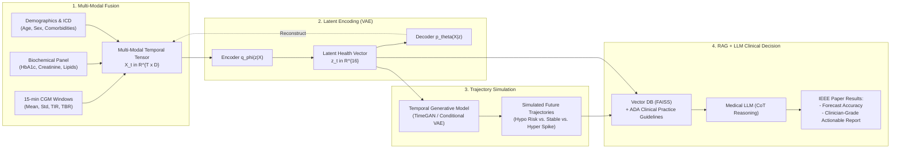

# IEEE Publication Blueprint & Attribute Feature Matrix
**Target IEEE Venues**: 
- *IEEE Journal of Biomedical and Health Informatics (JBHI)*
- *IEEE Transactions on Artificial Intelligence (TAI)*
- *IEEE International Conference on Bioinformatics and Biomedicine (BIBM)*
- *IEEE EMBC (Engineering in Medicine and Biology Conference)*

---

## 1. Proposed IEEE Paper Title & Core Novelty

> **Proposed Title**: 
> *"A Multi-Modal Variational Latent Space and Generative Trajectory Simulation Framework Grounded with RAG-LLMs for Personalized Type 1 Diabetes Prognosis"*

### The Research Gap & IEEE-Level Contribution:
1. **Limitation of Existing Work**: Prior diabetes studies either perform purely single-step glucose forecasting (predicting $t+30$ min using only CGM) or examine static tabular data (HbA1c/lipids), ignoring the complex longitudinal interplay between continuous interstitial glucose volatility and laboratory organ-damage biomarkers.
2. **Your Novel Contribution**:
   - **Unified Multi-Modal Latent Embedding**: Formulates a VAE/AutoEncoder that fuses high-frequency CGM temporal dynamics (15-min) with sparse clinical laboratory biomarkers (HbA1c, Creatinine, Lipids).
   - **Controllable Long-Horizon Generative Trajectory Simulation**: A temporal generative model (TimeGAN/Conditional Diffusion/Recurrent VAE) that simulates multi-day future glycemic trajectories conditioned on patient metabolic state.
   - **Evidence-Grounded Clinical Reasoning (RAG-LLM)**: Integrates the simulated trajectories with American Diabetes Association (ADA) clinical guidelines via a Retrieval-Augmented Generation (RAG) agent to produce explainable, doctor-facing clinical intervention recommendations.

---

## 2. Exact Attribute Matrix: What to Extract, Intervene, and Model

Here is the exact mapping of every column across the 4 dataset files into your machine learning and generative modeling pipeline:

### Table A: High-Frequency Temporal Attributes (`Glucose_measurements.csv`)
| Raw Attribute | Data Type | Machine Learning Role | Engineering & Feature Intervention |
| :--- | :--- | :--- | :--- |
| `Patient_ID` | String | Index / Grouping Key | Used for patient-wise train/val/test splitting (e.g., 70/15/15) to prevent data leakage. |
| `Measurement_date` + `Measurement_time` | Date/Time | Temporal Index | Convert into continuous Unix timestamps or 24-hour cyclical sinusoidal features: $\sin\left(\frac{2\pi \cdot t}{24}\right), \cos\left(\frac{2\pi \cdot t}{24}\right)$ to capture diurnal circadian rhythms. |
| `Measurement` | Float (mg/dL) | **Core Dynamic Feature & Target** | 1. Rolling window feature extraction ($W=16$ steps = 4 hours): Mean, Standard Deviation, Rate of Change ($dG/dt$). 2. Clinical metrics: **TIR** ($70-180$), **TBR** ($<70$), **TAR** ($>180$). 3. Target in Generative Simulation: Future trajectory $[G_{t+1}, \dots, G_{t+H}]$. |

---

### Table B: Laboratory Biomarkers (`Biochemical_parameters.csv`)
Out of the 17 available lab tests, focus on these **5 core clinical biomarker clusters**:

| Biochemical Attribute (`Name`) | Clinical Interpretation | Role in Model | Intervention & Preprocessing |
| :--- | :--- | :--- | :--- |
| **`Glycated hemoglobin (A1c)`** | 3-month glycemic history (Mean: 7.82%) | **Conditioning Vector / Long-term Ground Truth** | Normalized ($z$-score). Forward-filled across active CGM periods. Directly conditions the generative model. |
| **`Creatinine` & `Albumin (urine)`** | Renal function / Diabetic Nephropathy | Health State Latent Feature | Identifies if patient has early microvascular kidney damage. |
| **`Total cholesterol`, `HDL`, `Triglycerides`** | Cardiovascular / Lipid Profile | Multi-modal Health Conditioning | Quantifies metabolic syndrome comorbidity. |
| **`Alanine transaminase (GPT)`, `GGT`** | Hepatic (Liver) Function | Health State Latent Feature | Encodes liver gluconeogenesis and insulin clearance health. |
| **`Thyrotropin (TSH)`** | Autoimmune thyroiditis | Auxiliary Phenotype | Distinguishes poly-autoimmune disease profiles. |

---

### Table C: Baseline Demographics (`Patient_info.csv`)
| Raw Attribute | Clinical Meaning | Feature Type | Modeling Role |
| :--- | :--- | :--- | :--- |
| `Sex` | Biological sex (`M`/`F`) | Binary Categorical | One-hot encoded $\in \{0, 1\}$. Used as static condition $c$. |
| `Birth_year` | Age indicator | Continuous / Integer | Compute `Age = 2022 - Birth_year`. Standardized into $[0, 1]$. |
| `Number_of_days_with_measures` | Data density | Quality Filter | Filter out patients with insufficient continuous data ($< 60$ days). |

---

### Table D: Diagnostics & Comorbidities (`Diagnostics.csv`)
| Raw Attribute | Machine Learning Role | Usage in RAG-LLM |
| :--- | :--- | :--- |
| `Code` & `Description` | Multi-hot Comorbidity Vector or SciSpacy Entity Embedding | Feeds into the VAE to guide latent health representation, and serves as ground truth patient history in the **RAG retrieval prompt**. |

---

## 3. End-to-End IEEE Pipeline Architecture

---

## 4. Methodological Formulation for the IEEE Paper

### Step 1: Latent Representation Formulation (VAE)
Let the multi-modal patient state at window $t$ be represented as $\mathbf{x}_t = [\mathbf{g}_t, \mathbf{b}_t, \mathbf{c}]$, where $\mathbf{g}_t$ is the CGM summary dynamics, $\mathbf{b}_t$ is the imputed lab biomarker vector, and $\mathbf{c}$ is the static demographic vector.
The variational autoencoder maps $\mathbf{x}_t$ to latent space $\mathbf{z}_t \sim \mathcal{N}(\boldsymbol{\mu}_\phi(\mathbf{x}_t), \boldsymbol{\Sigma}_\phi(\mathbf{x}_t))$:
$$\mathcal{L}_{\text{VAE}} = \|\mathbf{x}_t - \hat{\mathbf{x}}_t\|_2^2 + \beta D_{\text{KL}}\left(\mathcal{N}(\boldsymbol{\mu}_\phi, \boldsymbol{\Sigma}_\phi) \,\|\, \mathcal{N}(\mathbf{0}, \mathbf{I})\right)$$

### Step 2: Generative Trajectory Simulation
Train a conditional sequence generator $G_\psi$ to model transition dynamics across time horizons $H \in \{2\text{ hours}, 4\text{ hours}, 12\text{ hours}\}$:
$$\hat{\mathbf{g}}_{t+1:t+H} = G_\psi(\mathbf{z}_t, \boldsymbol{\epsilon}), \quad \boldsymbol{\epsilon} \sim \mathcal{N}(\mathbf{0}, \mathbf{I})$$
This allows generating realistic future glucose paths reflecting different metabolic scenarios.

### Step 3: RAG-Grounded Clinical Decision Support
1. Construct the clinical state summary query:
   $$\mathbf{q}_t = \text{Concat}(\text{Patient Age}, \text{Current HbA1c}, \text{Simulated Risk of Hypoglycemia } P(G < 70))$$
2. Retrieve top-$k$ relevant clinical directives from American Diabetes Association (ADA) guidelines via semantic search in FAISS.
3. Pass through a Chain-of-Thought (CoT) prompt template to generate explainable recommendations for medication or lifestyle adjustment.

---

## 5. Experimental Setup & Metrics for IEEE Reviewers

| Component | Baseline Models to Compare Against | Quantitative Evaluation Metrics |
| :--- | :--- | :--- |
| **Latent Representation (VAE)** | Standard AutoEncoder, PCA, UMAP | Reconstruction MSE, Latent Space Disentanglement ($\beta$-VAE metric) |
| **Trajectory Simulation** | ARIMA, Standard LSTM, Vanilla GAN | **Clarke Error Grid (Zone A+B %)**, RMSE, MAE, Dynamic Time Warping (DTW) distance to real trajectories |
| **RAG + LLM Clinical Insight** | Zero-Shot LLM (no RAG), Standard Prompting | Clinical Correctness (expert-reviewed), Guideline Hallucination Rate, BLEU / ROUGE against ground-truth clinical guidelines |
