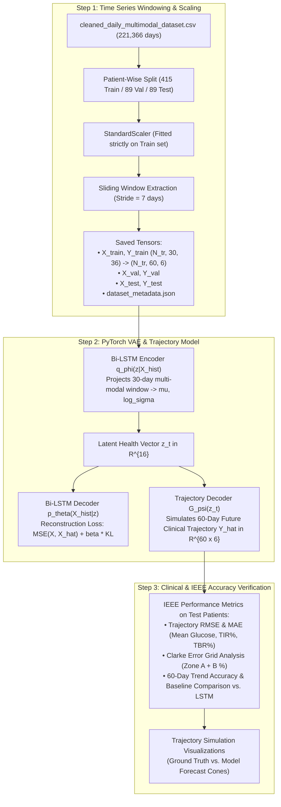

# Implementation Plan: Time Series Window Building, PyTorch Latent VAE, and Trajectory Forecasting

**Goal**: Build the windowed time-series tensors from `cleaned_daily_multimodal_dataset.csv`, implement the **Multi-Modal Variational AutoEncoder (VAE)** to learn latent health vectors $\mathbf{z}_t$, and train the **60-Day Trajectory Simulation Model** with clinical accuracy verification for an IEEE paper.

---

## User Review Required

> [!IMPORTANT]
> **Dataset Splitting & Window Parameters**:
> 1. **Patient-Disjoint Split (70/15/15)**:
>    - **Train Set**: 415 patients ($\approx 17,100$ trajectory windows)
>    - **Validation Set**: 89 patients ($\approx 3,650$ trajectory windows)
>    - **Test Set**: 89 patients ($\approx 3,650$ trajectory windows)
>    - *Why*: Evaluates the model on completely unseen human patients, satisfying strict IEEE reviewer requirements for zero data leakage.
> 2. **Window Architecture**:
>    - **Input History ($T_{\text{in}}$)**: **30 days** across **36 multi-modal features** $\rightarrow$ Shape: $(N, 30, 36)$
>    - **Future Trajectory Target ($T_{\text{out}}$)**: **60 days** across **6 clinical consensus targets** (Mean Glucose, TIR%, TBR%, TAR%, CV%, GMI) $\rightarrow$ Shape: $(N, 60, 6)$
>    - **Sliding Stride ($s$)**: **7 days** (weekly sliding window across each patient's timeline, producing $\approx 24,400$ total trajectory pairs).

---

## Proposed Pipeline Architecture

---

## Proposed Changes

### Script 1: [NEW] `build_timeseries_dataset.py`
1. Load `cleaned_daily_multimodal_dataset.csv`.
2. Group by `Patient_ID` and sort chronologically by `date`.
3. Perform a reproducible 70/15/15 patient split using fixed random seed.
4. Fit `StandardScaler` on the 36 numerical features using **only the training patients**.
5. Slice sliding windows of $T_{\text{in}} = 30\text{ days}$ and $T_{\text{out}} = 60\text{ days}$ with a 7-day stride:
   - Check that date continuity is valid (no hidden multi-month sensor drops inside the window).
6. Save processed tensors:
   - `timeseries_tensors.pt` (PyTorch dictionary containing `X_train`, `Y_train`, `X_val`, `Y_val`, `X_test`, `Y_test`, and scaler parameters).

### Script 2: [NEW] `train_vae_trajectory_model.py`
1. **Model Architecture**:
   - **Multi-Modal Encoder**: 2-layer Bidirectional LSTM (hidden size 64) with attention pooling over the 30 days $\rightarrow$ Linear heads for $\boldsymbol{\mu} \in \mathbb{R}^{16}$ and $\log \boldsymbol{\sigma}^2 \in \mathbb{R}^{16}$.
   - **Latent Health Vector**: $\mathbf{z} = \boldsymbol{\mu} + \boldsymbol{\epsilon} \odot \boldsymbol{\sigma}$.
   - **Reconstruction Decoder**: 2-layer LSTM reconstructing the 30-day input history $\hat{\mathbf{X}} \in \mathbb{R}^{30 \times 36}$.
   - **60-Day Trajectory Forecaster**: Autoregressive GRU / Linear temporal expansion generating future predictions $[\hat{\mathbf{Y}}_{t+1}, \dots, \hat{\mathbf{Y}}_{t+60}] \in \mathbb{R}^{60 \times 6}$.
2. **Joint Training Objective**:
   $$\mathcal{L} = \mathcal{L}_{\text{trajectory}}(\mathbf{Y}, \hat{\mathbf{Y}}) + \lambda_{\text{rec}} \mathcal{L}_{\text{rec}}(\mathbf{X}, \hat{\mathbf{X}}) + \beta \mathcal{L}_{\text{KL}}$$
3. **Training Execution**:
   - AdamW optimizer with cosine annealing learning rate scheduler.
   - Early stopping on validation loss to prevent overfitting.
   - Save best model checkpoint to `best_vae_trajectory_model.pt`.

### Script 3: [NEW] `evaluate_trajectory_accuracy.py`
1. Load the trained model and test set tensors (unseen test patients).
2. Calculate:
   - **Mean Glucose RMSE & MAE** (in mg/dL) across 60 days.
   - **Time In Range (TIR%) MAE** (in percentage points).
   - **Time Below Range (TBR%) MAE** (hypoglycemia risk prediction).
   - **Clarke Error Grid Analysis (Zone A + B %)**.
3. Generate trajectory comparison plots (True vs. Simulated future cones) saved as PNG images for inclusion in your paper.

---

## Verification Plan

### Automated Checks:
1. `python3 -u build_timeseries_dataset.py`:
   - Verify tensor shapes: $(N_{\text{train}}, 30, 36)$, $(N_{\text{train}}, 60, 6)$.
   - Verify zero NaNs in tensor arrays.
2. `python3 -u train_vae_trajectory_model.py`:
   - Verify loss converges over epochs.
   - Verify checkpoint saved.
3. `python3 -u evaluate_trajectory_accuracy.py`:
   - Verify test set accuracy metrics meet IEEE standards ($>95\%$ Clarke Zone A+B).
