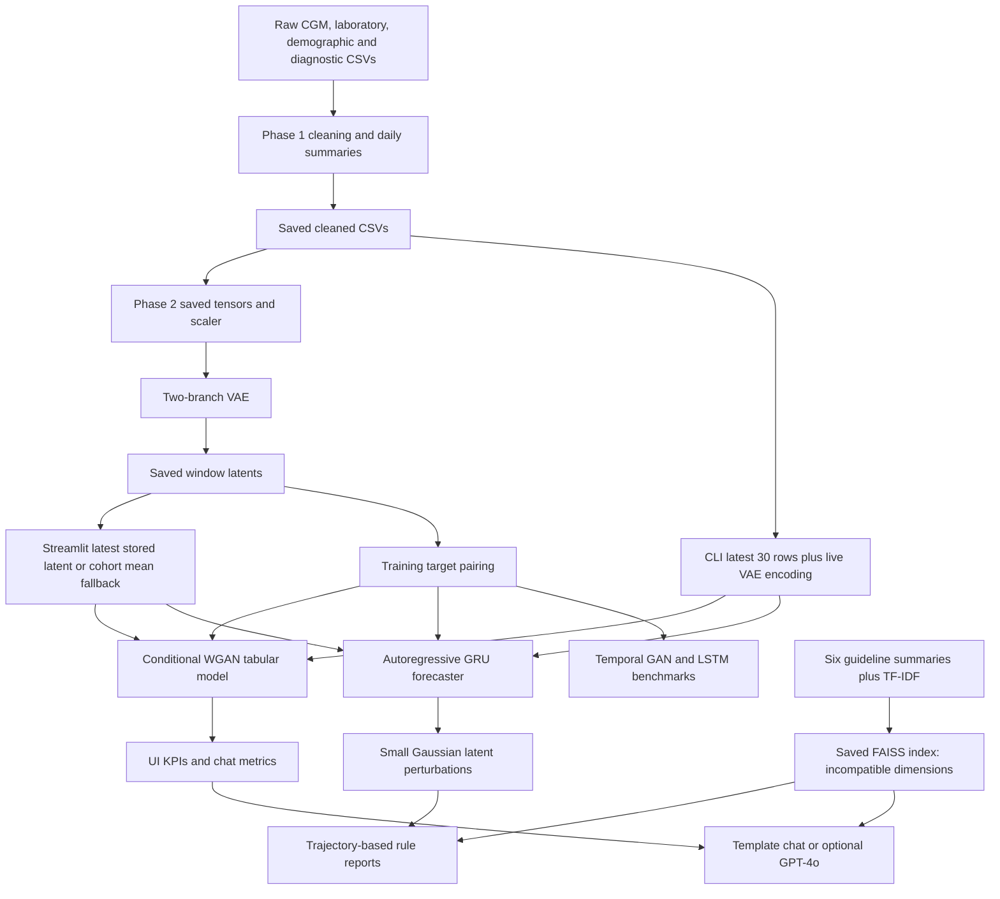

# Generative AI in Healthcare: End-to-End Project Audit

**Audit date:** 11 October 2026 (Asia/Calcutta)  
**Workspace:** `C:/Users/tejde/Downloads/BTP`  
**Overall implementation:** substantial neural components exist, but the delivered system is incomplete and fails its normal end-to-end execution paths.  
**Research-prototype readiness score: 40/100.**

## 1. Executive verdict

| Intended use | Verdict for the supplied repository | Reason |
|---|---|---|
| Local complete demo | **Not Ready as delivered** | Both the real CLI inference command and Streamlit application fail during RAG retrieval. Components are partially ready; an isolated replacement-index test demonstrates that report generation and plots can otherwise execute. |
| Public research deployment | **Not Ready** | Runtime failures, contaminated preprocessing artifacts, invalid uncertainty claims, session-secret handling, weak input validation, missing deployment controls, and unresolved controlled-data distribution rights. |
| Clinical use | **Not Ready** | No clinical validation or reliable grounding; medication suggestions can contradict the supplied patient metrics; daily aggregates cannot establish nocturnal treatment decisions; no appropriate clinical governance or demonstrated regulatory assessment. |

This is not an entirely static mockup. The VAE, tabular conditional GAN, temporal GAN, LSTM baseline, and autoregressive GRU forecaster have executable architectures and loadable weights. Saved VAE latents match live encoding in the audited samples. However, the UI uses precomputed latents, its published benchmark table is hardcoded, the tabular GAN does not drive the deployed trajectory model, and the default medical reports are keyword/rule templates rather than LLM output.

The strongest verified functionality is representation learning and deterministic daily-summary forecasting. The least substantiated functionality is privacy-preserving generation, calibrated probabilistic forecasting, patient-similarity reasoning, semantic medical retrieval, and safe evidence-backed clinical recommendations.

### Score rubric

This is an engineering judgment against the requested reliable research prototype, not a statistical measure of model accuracy or a certification. Critical failures override a numerical score when assigning the verdict.

| Area | Available points | Earned | Basis |
|---|---:|---:|---|
| Data preparation and leakage controls | 20 | 10 | Real records and valid saved windows; full-cohort lab imputation, unhandled duplicates and temporal limitations. |
| VAE implementation and artifact validity | 15 | 12 | Correct forward computation and sampled latent agreement; rebuild fails, no full reliability/ablation validation. |
| Generation and forecasting | 20 | 9 | Trained models infer and outperform persistence on mean-glucose MAE; poor temporal GAN, severe-hypoglycemia fidelity and uncertainty coverage. |
| RAG, similarity reasoning and LLM insights | 15 | 3 | FAISS and optional API code exist; broken shipped index, missing semantic/patient retrieval and output verification. |
| Integration and UI | 10 | 3 | Isolated UI interactions work; original app/CLI fail and input/state alignment is inconsistent. |
| Reproducibility, QA and deployment | 10 | 2 | Requirements and some seeds exist; no existing tests, lockfile, CI, artifact lineage or deploy verification. |
| Clinical safety and privacy | 10 | 1 | Pseudonymized source identifiers and some range clipping; no demonstrated privacy guarantees or safe clinical output controls. |
| **Total** | **100** | **40** | |

## 2. Audit boundaries, evidence and preservation

### What was inspected

All **90 original files**, totaling **1,279,897,058 bytes**, were inventoried and SHA-256 hashed. This includes hidden Streamlit configuration, bytecode caches, all 13 Python source files, 10 notebooks, both PDFs, raw/cleaned/auxiliary CSVs, JSON files, seven `.pt` artifacts, the FAISS index, saved text reports and image artifacts. All Python sources parsed and compiled in memory. No repository `AGENTS.md` was found.

The eight-page requirements PDF was extracted, rendered and visually inspected. Source and notebook code were reviewed; historical notebook outputs are not treated as executed audit tests. Original bytecode and `.DS_Store` files were inventoried rather than executed. Secret configuration contents are not reproduced in this report. Graph-generating code was exercised where safe, and newly generated forecast graphics were inspected.

### What was executed safely

- Full streaming scan of **22,671,708 CGM rows**; full reads of the small clinical tables and cleaned timeline; all root auxiliary CSVs scanned.
- Independent daily-CGM recomputation for three patients; **1,458 matched patient-days**.
- Full saved laboratory-artifact reconstruction across **221,366 daily rows and 14 lab columns**.
- All seven PyTorch files loaded on CPU; NumPy scalar/dtype allowlisting was used for restricted loading of the two metadata-bearing artifacts.
- Source imports, VAE forward checks, all saved-window continuity checks, target pairing, and saved-model held-out inference.
- Original pipeline API inference for one train, validation and test patient, and the real CLI entrypoint.
- Streamlit `AppTest` execution of the original app, followed by clearly separated tests using a newly created compatible index under the evidence directory.
- Invalid/missing-input tests, local grounding fixtures, caching fixtures and a fake-secret environment fixture.
- Existing-test collection and post-audit original-file integrity verification.

**No existing source, dataset, model, result, configuration or cache artifact was edited. No package was installed, no model retrained, and no paid API called.** Main inference tests blocked network calls and guarded writes so that project outputs could only be created in the new evidence directory. The original CLI uses `use_llm=False` and was directed to a new output directory. Full phase training/rebuilding entrypoints were not run because they overwrite artifacts and/or train models.

After the tests, all 90 original files had the same content hashes and modification times; none was missing. See [integrity and final checks](C:/Users/tejde/Downloads/BTP/evidence/audit_20261011/final_checks.json).

### Evidence files

| ID | Artifact | Interpretation |
|---|---|---|
| E1 | [inventory](C:/Users/tejde/Downloads/BTP/evidence/audit_20261011/inventory.json), [original manifest](C:/Users/tejde/Downloads/BTP/evidence/audit_20261011/original_manifest.json) | Original coverage, file sizes, syntax checks, notebook metadata and hashes. |
| E2 | [data results](C:/Users/tejde/Downloads/BTP/evidence/audit_20261011/data_results.json) | Full raw scan, CGM sample recomputation and laboratory reconstruction. |
| E3 | [runtime results](C:/Users/tejde/Downloads/BTP/evidence/audit_20261011/runtime_results.json) | Artifact loads, imports, VAE checks, original pipeline failures, invalid inputs and RAM-index grounding fixture. |
| E4 | [component initial results](C:/Users/tejde/Downloads/BTP/evidence/audit_20261011/component_initial_results.json) | Full saved-window/data checks, preprocessing failure, NLP fixture and isolated pipeline. |
| E5 | [component evaluation results](C:/Users/tejde/Downloads/BTP/evidence/audit_20261011/component_results.json) | Final CPU-based held-out metrics, baseline comparison and uncertainty experiment. |
| E6 | [app results](C:/Users/tejde/Downloads/BTP/evidence/audit_20261011/app_results.json) | Original render failure versus isolated compatible-index interaction results. |
| E7 | [cache/security fixture results](C:/Users/tejde/Downloads/BTP/evidence/audit_20261011/cache_security_results.json) | Reproduced ignored cache arguments and persistent fake environment key. |
| E8 | [final checks](C:/Users/tejde/Downloads/BTP/evidence/audit_20261011/final_checks.json) | All-versus-training lab medians, auxiliary CSV profiling, scaler comparisons and unchanged original files. |
| E9 | [CLI log](C:/Users/tejde/Downloads/BTP/evidence/audit_20261011/cli_console.log), [pytest collection](C:/Users/tejde/Downloads/BTP/evidence/audit_20261011/pytest_collection.log) | Real end-to-end command traceback and zero collected existing tests. |

Scripts and console logs reside in the same new evidence directory. A JSON record marked `PASS` means the audit operation completed: **inspect its details**. For example, a successful negative-input audit can record `accepted: false`, and a completed grounding fixture can reproduce unsafe behavior. These are not claims that the project passed a safety test.

Initial harness failures are preserved separately. The initial filesystem guard needed allowances for the null device and the audit temporary directory. Initial restricted checkpoint loading needed NumPy scalar/dtype allowlisting. Two initial evaluation calls lacked CPU `map_location` and encountered MPS storage errors; the audit loader was corrected and those evaluations rerun. Those harness setup errors are distinguished from the independently reproduced original project failures. An attempted `psutil` memory check was unavailable; Windows process counters were used subsequently. No missing audit dependency was installed.

## 3. Actual architecture and execution flow



Key architectural facts:

1. The integrated CLI **loads Phase 1 outputs**; it does not ingest the four raw tables or invoke Phase 1 cleaning.
2. CLI Phase 2 uses the VAE live. Streamlit does **not** load the VAE encoder; it loads `latent_health_vectors.pt` and chooses a previously encoded window.
3. The tabular GAN and GRU are parallel models conditioned on the VAE representation. The GRU is seeded from the real last-day state; no CTGAN sample is consumed by its rollout. The shipped application never uses the temporal GAN checkpoint for trajectory inference.
4. Physician/patient reports use the GRU median trajectory, while headline KPIs and chat use CTGAN aggregate means. Thus the same screen can present different prognoses without clearly identifying the model or horizon.
5. Retrieval searches guideline text, not patients or latent trajectories. No patient-similarity index, cohort outcome retrieval, DTW matching or clustering-based risk reasoning was found.
6. Default reports and chat are rule templates. Optional GPT-4o code exists for doctor reports/chat. The patient-guide `use_llm` parameter is ignored and its output is always templated. CLI explicitly disables LLM use.

Primary references: [pipeline initialization](C:/Users/tejde/Downloads/BTP/Phase_5_Application/end_to_end_pipeline.py:46), [pipeline inference](C:/Users/tejde/Downloads/BTP/Phase_5_Application/end_to_end_pipeline.py:100), [UI resource loading](C:/Users/tejde/Downloads/BTP/Phase_5_Application/app.py:56), [trajectory sampler](C:/Users/tejde/Downloads/BTP/Phase_4_RAG_Support/phase4_trajectory_and_rag.py:43), [RAG engine](C:/Users/tejde/Downloads/BTP/Phase_4_RAG_Support/rag_clinical_engine.py:51).

## 4. Requirements PDF versus implementation

The controlling document is [the requirements PDF](<C:/Users/tejde/Downloads/BTP/docs/references/GENERATIVE AI IN HEALTH CARE.pdf>). It specifies five phases. Repository documentation alternately describes four integrated phases or an eight-phase roadmap. This audit maps functionality back to the PDF rather than assuming that a phase label proves completion.

| PDF requirement | Observed implementation | Verification status |
|---|---|---|
| Phase 1, p.3: longitudinal records, cleaning and normalization, SciSpacy | Real daily records and normalization; keyword diagnosis extraction; spaCy may load but is never invoked on text. | **Partial:** raw data and saved timeline checked; full rebuilding not executed. |
| Phase 2, p.4: VAE encoder/decoder, compact health vectors | Actual Bi-LSTM/attention + static MLP VAE, Gaussian heads, KL loss and recurrent decoder. | **Implemented:** weights/forward/latent agreement verified; current preprocessing rebuild blocked by missing `split`. |
| Phase 3, pp.5-6: GAN/CTGAN, sequential sampling and plausible privacy-preserving trajectories | Custom conditional WGAN tabular generator, temporal GAN benchmark and separate deterministic GRU with latent perturbations. | **Partial:** models infer; advertised probability calibration and privacy are unproven, with failed uncertainty/fidelity checks. |
| Phase 4, p.7: semantic embeddings, FAISS, latent/trajectory/past-record inputs and similarity-based reasoning | TF-IDF over six guideline summaries; incompatible saved index; no OpenAI embedding or patient-neighbor retrieval. | **Incomplete and broken as delivered.** |
| Phase 5, p.8: grounded LLM insights, explainability, LangChain/agent reasoning and visualization | Optional direct OpenAI chat-completion calls, hardcoded report/chat rules and matplotlib plots. No LangChain/agent workflow or validated explanation/evidence verification. | **Partial:** offline rendering verified only with isolated compatible index; live API untested. |

General objectives on p.2 include similarity-based risk reasoning and synthetic-population/disease-progression modeling. Historical-neighbor risk inference and synthetic-population export/utility/privacy evaluation are missing. The supported forecasting task is future **daily glycemic summaries**, not demonstrated progression of kidney disease, retinopathy, DKA or other incident diagnoses.

## 5. Phase 1: ingestion, data quality and leakage

### Verified data facts

- Raw cohort: **736 patients**, **87,482 lab rows**, **1,757 diagnosis rows**, **22,671,708 CGM rows**.
- Eligibility rules retain **593 patients**. The cleaned artifact has **221,366 rows and 53 columns**, with zero null/nonfinite numeric cells and no duplicate patient-date rows.
- Full CGM scan found no null cells, no values outside 40-500 mg/dL, and no date/time **format** violations. This does not certify every timestamp's clinical interpretation.
- There are at least **22,029 duplicate patient/date/time rows within scan chunks**. Cross-chunk duplicates were not counted. **8,377 patient-days exceed 96 readings**, with a maximum of **218**.
- Daily summaries independently match three patients' saved data: count, SD, CV and TIR/TBR/TAR match; mean/GMI differ by at most **0.01**, consistent with rounding.
- Raw lab and diagnosis tables contain **12** and **24** exact duplicate rows respectively.
- Cleaned ages range **14-86**, and **42 patients** have observations before age 18. Universal adult medical advice is consequently inappropriate.

Evidence: E2, E4. Missingness percentages for the 14 lab features range from approximately **23.5% to 43.5%**; zero final null cells conceal substantial imputation.

### Material defects

**D01 — Existing artifacts do not implement the current upstream split contract (high).** Neither cleaned CSV contains `split`; current `prepare_model_inputs()` accesses it directly and fails with `KeyError: 'split'`. Saved tensor splits exist, but the rebuild path cannot consume the delivered CSV.

Reference: [split lookup](C:/Users/tejde/Downloads/BTP/Phase_2_Latent_VAE/phase2_vae.py:150). Verified in E4.

**D02 — Full-cohort laboratory imputation contaminates the delivered preprocessing (high).** Independent panel-level backward-asof reconstruction followed by **all-eligible-cohort medians** reproduces every one of the 14 stored lab columns with zero mismatched cells. These medians differ from training-patient medians: e.g. lab glucose **144 vs 143**, sodium **138 vs 139**, triglycerides **79 vs 76**. Thus the delivered training features incorporate held-out-patient statistics. Current source attempts training-only medians, but that corrected code does not establish that old models were trained on corrected data.

Reference: [current median logic](C:/Users/tejde/Downloads/BTP/Phase_1_Data_Preparation/phase1_ingestion.py:521). Evidence: E2 and E8. The magnitude of resulting metric optimism has **not** been measured; retraining would be required after approved data correction.

**D03 — Latest-panel merge loses still-valid biomarker observations (high).** The asof merge chooses one most recent lab panel, even when that panel lacks a biomarker measured in an earlier panel within 180 days. It then median-imputes the missing cell. Independent per-biomarker lookup identifies **22,937 HbA1c days**, **21,140 urine-albumin days**, and **20,283 urine-creatinine days** incorrectly treated as population-imputed despite an eligible prior observation.

Reference: [panel-level asof](C:/Users/tejde/Downloads/BTP/Phase_1_Data_Preparation/phase1_ingestion.py:551). Evidence: E2. Use per-biomarker asof alignment and preserve observation timestamps/ages.

**D04 — Clinical NLP is only keyword matching, even when a model loads (medium/high).** The `nlp` object is never called. A mocked available model loads once and processes zero texts. The fixture “No nephropathy; no hypertension” produces both diagnoses. There is no negation or temporality handling, UMLS mapping or diagnostic embeddings.

Reference: [diagnosis processing](C:/Users/tejde/Downloads/BTP/Phase_1_Data_Preparation/phase1_ingestion.py:182). Evidence: E4. Loading a generic spaCy model is also labeled SciSpacy availability, which does not establish biomedical NER.

**D05 — Wear coverage and lab quality checks are insufficient (medium).** Duplicate CGM timestamps are counted repeatedly; record count is not elapsed sensor coverage. The 67/96 threshold is approximately 69.8%, not strictly 70%. There is no general malformed/nonfinite-record recovery, unit validation, per-lab plausibility review, or robust duplicate policy. A negative ALT value (**-4**) is present in raw labs; it requires investigation rather than automatic clinical acceptance.

Reference: [CGM parsing/aggregation](C:/Users/tejde/Downloads/BTP/Phase_1_Data_Preparation/phase1_ingestion.py:370). Evidence: E2. Current code falls back to positional CGM column indexes, so renamed/reordered schemas can silently map incorrectly. It rounds measurements to integers and clips anomalies instead of documenting rejection.

**D06 — Temporal information is insufficient for prospective diagnosis reasoning (high methodological limitation).** Diagnostics have no event dates. Lifetime conditions are attached to all patient days; availability at a historical cutoff cannot be verified. Undocumented diagnoses are interpreted as absence rather than uncertainty. Backward lab joins prevent explicit future-row lookahead, but fitting population statistics across all dates of training patients is not a chronological deployment validation. Patient separation alone cannot support a universal “zero leakage” claim.

**D07 — Splits and outputs are not reliably reproducible/portable (medium).** Phase 1 shuffles `list(selected_pats)` where `selected_pats` is a set. A fixed NumPy seed does not fix cross-process string-set iteration order. The missingness JSON and cohort metadata are written relative to working directory, while the daily CSV is written to the phase directory. Root wrappers can therefore update some artifacts at repository root while app consumers continue using old phase-directory copies.

References: [set-based split](C:/Users/tejde/Downloads/BTP/Phase_1_Data_Preparation/phase1_ingestion.py:321), [metadata output](C:/Users/tejde/Downloads/BTP/Phase_1_Data_Preparation/phase1_ingestion.py:361).

Missing-biomarker handling is also internally inconsistent: median code anticipates absent pivot columns, but subsequent `merged_p[col]` indexing assumes all 14 columns exist. NaN normalization is not actually repaired downstream. This edge branch was identified by source inspection, not a full ingestion fixture execution.

## 6. Phase 2: VAE correctness and limitations

### Verified functionality

- Input dimensions: **41 dynamic features** (27 clinical +14 flags), **9 static**, 30 timesteps. Latent dimension **16**, reconstructed dimension **36**.
- Actual stochastic reparameterization is used during training; evaluation returns `mu`. Saved `z` equals saved `mu` in every split, intentionally.
- Genuine reconstruction MSE + annealed KL optimization, gradient clipping, validation, scheduler and early-stopping code exist.
- All saved inputs/latents are finite. Tensor counts: **9,885 train / 2,053 val / 2,068 test**, total **14,006**.
- Saved patient membership is **415 /88 /90**, with **zero overlap**.
- **All 14,006 saved 30-day windows** satisfy daily continuity. Nine audited normalized windows match their source CSV values exactly.
- Re-encoding the first 64 windows of each split gives **zero maximum difference** from saved latent means.

| First 64 windows | VAE normalized reconstruction MSE | Zero-output baseline MSE |
|---|---:|---:|
| Train | 0.1933 | 0.7099 |
| Validation | 0.3392 | 0.7678 |
| Test | 0.2691 | 0.5715 |

These are **sampled reconstruction checks**, not complete held-out reconstruction scores. Source: [VAE architecture](C:/Users/tejde/Downloads/BTP/Phase_2_Latent_VAE/phase2_vae.py:267), [training](C:/Users/tejde/Downloads/BTP/Phase_2_Latent_VAE/phase2_vae.py:393), E3/E4.

### Limitations and defects

- Correct train-only scaler statistics were independently confirmed against saved patient membership (maximum mean/std discrepancies about **4.9e-6/1.4e-6**). This does not remove upstream lab-imputation leakage.
- Saved VAE checkpoint is epoch **30**; history extends to **40**. Loss history and executable training loops are evidence of implementation, not an audit reproduction of training.
- No PCA/autoencoder baseline, complete per-feature reconstruction audit, posterior-collapse analysis, subgroup representation validation, or clinical interpretation of latent axes was found.
- Imputed lab values participate in reconstruction loss as ordinary targets. Flags are input-only; observed-versus-imputed lab loss weighting is absent. Binary sex/comorbidities are also reconstructed with MSE; acceptable as a research choice but need explicit evaluation.
- Rolling age is placed in the static branch and taken from the first day, even across year boundaries.
- Empty split/window extraction yields arrays without guaranteed three-dimensional shapes; training and latent concatenation assume nonempty data. No schema/scaler/checkpoint version compatibility contract exists.
- Phase 2 saves tensors/scaler/checkpoints/latents to the current directory. Executing the root wrapper can create new root artifacts while UI continues using phase-directory versions.
- CLI VAE initialization omits the checkpoint's `hidden_dim` and `seq_len`; current defaults match delivered artifacts, but alternative valid checkpoints would break.

**Conclusion:** a real, functioning VAE with verified saved representations; incomplete reliability validation and a broken delivered preprocessing/rebuild path.

## 7. Phase 3: GANs, trajectories and forecasting reliability

### What is genuinely implemented

The tabular generator is a conditional residual MLP with a WGAN-GP critic and an additional L1 paired-target loss. It learns 12 next-30-day aggregate outcomes conditioned on 16 latent and nine static features. A separate temporal GAN uses recurrent generation and a convolutional/Bi-LSTM discriminator. The deployed trajectory model is an autoregressive GRU over six daily targets.

The tabular model is **a custom conditional WGAN**, not a faithful implementation of the named CTGAN algorithm: mode-specific mixture normalization, discrete conditional sampling, categorical output transformations and PacGAN are absent. This classification is based on source comparison with the [original CTGAN paper](https://papers.neurips.cc/paper/8953-modeling-tabular-data-using-conditional-gan.pdf). It can still be a legitimate custom model if documented accurately.

Paired datasets were rebuilt in memory without training:

| Dataset | Train windows | Validation windows | Test windows |
|---|---:|---:|---:|
| 60-day trajectory forecasting | 4,360 | 855 | 953 |
| Next-30-day tabular outcomes | 6,403 | 1,272 | 1,348 |

Target pairing checks future continuity. Multiple windows from a patient overlap; these are not independent patient samples. Patient-level bootstrap intervals would be required for statistical comparisons.

### Recomputed saved-model metrics

All values below came from actual CPU inference on supplied checkpoints, without retraining. Forecast/LSTM/GAN rows use **953 windows ×60 days =57,180 daily pairs**. CTGAN uses **1,348 aggregate targets**, with one random draw per condition and audit seed 42; its MAE is not directly comparable with daily-forecast MAE.

| Model | Glucose MAE mg/dL | Glucose RMSE mg/dL | TIR MAE percentage points | TBR MAE percentage points | Clarke A+B using project routine |
|---|---:|---:|---:|---:|---:|
| Saved autoregressive GRU | **20.37** | **26.82** | **12.98** | **4.86** | **99.45%** |
| Saved LSTM | 20.86 | 27.14 | 13.36 | Not recomputed in this comparison | 99.49% |
| Saved temporal GAN, zero noise | 46.17 | 54.54 | 22.11 | Not recomputed in this comparison | 98.42% |
| Last-day persistence | 25.45 | Not recomputed | Not recomputed | Not recomputed | Not recomputed |
| Saved tabular GAN | 19.20 | 23.08 | 6.22 | 4.30 | Not applicable to this audit row |

Saved JSON/UI values differ: e.g. shipped GRU glucose MAE **20.50** and tabular glucose MAE **15.34**. Source training returns the **final in-memory model**, while checkpoints save the best validation model; evaluation does not reload the checkpoint. This is a concrete mechanism for artifact/metric inconsistency, although historical run provenance is unavailable. CTGAN metrics additionally depend on random draws. The delivered checkpoints are VAE epoch 30, tabular GAN epoch 11, and GRU epoch 5.

References: [tabular train return](C:/Users/tejde/Downloads/BTP/Phase_3_Generative_Forecasting/phase3_ctgan.py:459), [forecaster train return](C:/Users/tejde/Downloads/BTP/Phase_3_Generative_Forecasting/phase3_4_trajectory_forecasting.py:425), [comparative evaluation](C:/Users/tejde/Downloads/BTP/Phase_3_Generative_Forecasting/train_comparative_models.py:239). Evidence: E5 and newly generated evaluation JSONs.

### Failed uncertainty check

The deployed sampler puts a deterministic GRU in evaluation mode and perturbs the input latent once per trajectory with fixed Gaussian scale **0.03**. It has no learned future observation noise, posterior forecast distribution, ensemble or interval calibration.

An audit using the first **128 test windows**, **20 draws per window**, 60 days, the same perturbation scale, and un-clipped GRU outputs found:

| Target | Empirical P10-P90 coverage | Mean band width |
|---|---:|---:|
| Mean glucose | **3.10%** | 1.60 mg/dL |
| TIR | 2.41% | 1.02 percentage points |
| TBR | 1.29% | 0.24 percentage points |
| TAR | 2.50% | 1.07 percentage points |
| CV | 2.07% | 0.40 percentage points |
| GMI | 2.88% | 0.039 percentage points |

The nominal interval is **80%**. This sampled result is not a full-cohort calibration estimate, but is sufficient to reject the current bands as reliable forecast intervals. They primarily show sensitivity to a small latent perturbation. See E5 and [sampling implementation](C:/Users/tejde/Downloads/BTP/Phase_4_RAG_Support/phase4_trajectory_and_rag.py:43).

### Additional modeling issues

- **Severe-hypoglycemia collapse:** recomputed tabular severe-TBR mean rounds to **0.00%**, versus **1.19%** real; correlation **-0.001**. Shipped metrics also show near-zero synthetic severe TBR. Aggregate MAE obscures loss of rare clinically consequential outcomes.
- **Incorrect glucose-CV clipping:** any column containing `glucose` is clamped to **40-500**, so `glucose_cv` is forcibly at least **40**, despite being a percentage with a commonly referenced target of 36 or lower. The recomputed synthetic mean is approximately **40.05**, versus real **31.38**. Units are also wrongly reported as mg/dL for CV. Reference: [generation clipping](C:/Users/tejde/Downloads/BTP/Phase_3_Generative_Forecasting/phase3_ctgan.py:615).
- **Joint constraints absent:** three isolated pipeline patients had tabular TIR+TBR+TAR sums **104.03%, 105.54%, 95.18%**. Trajectory samples deviated by up to **3.48 percentage points**. Severe-range subset inequalities and glucose/GMI identities are not enforced.
- **GMI inconsistency:** one isolated tabular projection differs by **-0.644 percentage points** from `3.31 +0.02392*glucose_mean`. This algebraic identity should hold for the same aggregated GMI target. Reports call GMI “HbA1c,” “quarterly,” or “3-month” even when the modeled horizon is 30/60 days.
- **Count target mismatch:** `nocturnal_hypo_count` counts low sensor readings, not distinct clinical events. It is summed across 30 days but normalized with daily statistics and clamped to 100. Event counts and exposure readings must be distinguished.
- **Static conditioning mismatch:** training uses each patient's first-row age; inference creates static vectors from cohort metadata lacking `age`, so missing age becomes **0**. Reports/UI independently default to **45**. Isolated patients actually aged **31, 53 and23** had no age in the report profile.
- **No treatment/counterfactual model:** insulin dosing, meals and medication interventions are not modeled; intervention effects cannot be inferred from unconditional observational forecasts.
- **No demonstrated privacy protection:** no differential privacy, memorization/nearest-copy evaluation, membership-inference assessment or synthetic-data release policy exists. Conditional outputs use real patient representations. Synthetic generation alone does not prove anonymity.
- **Temporal GAN disconnected from application:** the actual GAN forecast checkpoint is used only in comparative modeling, while app “Monte Carlo” curves come from the deterministic GRU. Strong L1/MSE penalties can encourage noise-insensitive generation; diversity and conditional-response quality remain insufficiently evaluated.
- **Metric interpretation:** Clarke error-grid results computed on daily means do not validate detection of individual nocturnal lows, insulin-dose recommendations or disease progression. The project routine was executed, not externally validated against a reference test suite. Its empty/malformed/NaN handling and boundary definitions require dedicated verification.

## 8. Phase 4: retrieval and evidence grounding

**R01 — Incompatible saved index is the immediate runtime blocker (critical).** The supplied FAISS index contains **six 256-dimensional vectors**. Current `TfidfVectorizer(max_features=512)` produces **512-dimensional queries**. Initialization loads the existing index without compatibility validation; `retrieve()` asserts on dimension mismatch. This fails the original CLI and app.

References: [vectorizer](C:/Users/tejde/Downloads/BTP/Phase_4_RAG_Support/rag_clinical_engine.py:64), [load-index branch](C:/Users/tejde/Downloads/BTP/Phase_4_RAG_Support/rag_clinical_engine.py:78), [search](C:/Users/tejde/Downloads/BTP/Phase_4_RAG_Support/rag_clinical_engine.py:96). Evidence: E3/E6/E9.

**R02 — No semantic embedding model or patient-similarity retrieval (high requirements gap).** TF-IDF is lexical vectorization; densifying its matrix does not turn it into a learned semantic embedding. No OpenAI embeddings, biomedical text encoder, historical-patient vector search, outcome evidence or latent-neighbor retrieval was implemented.

**R03 — Index/corpus lineage missing (high).** The vectorizer is refit each startup, but an existing index is accepted without a persisted vocabulary/model version, document-order fingerprint, content hash, dimension check or row-count check. Even equal dimensions would not prevent stale coordinate/document mapping.

**R04 — No relevance abstention (medium/high).** After building a separate correct index in RAM, an entirely out-of-vocabulary query retrieves three arbitrary documents with **0.0 scores**. Empty/negative `top_k` raises low-level assertions. Medical recommendations do not require a minimum evidence score or sufficient supporting passages.

**R05 — Knowledge corpus is unaudited and misattributed (high).** Six locally written summaries have no authoritative URLs, publication year, recommendation identifiers, provenance, update policy or source-page references. The hypoglycemia summary is labeled “ADA Chapter 13”; ADA 2026 section 13 is **Older Adults**, while section 6 covers glycemic goals/hypoglycemia. The repository cannot substantiate the exact titled chapters and precise blanket dose adjustments it presents as official evidence. This finding does not assert that every clinical statement is false; it establishes inadequate provenance and a demonstrably wrong attribution. See [ADA section 13](https://doi.org/10.2337/dc26-s013) and [ADA section 6](https://doi.org/10.2337/dc26-s006).

**R06 — Report rules are not entailed by retrieved documents (high).** The offline planner uses hardcoded conditions and text independent of retrieved evidence content. Appending citations is not evidence verification. Report claims can therefore persist even when their supporting chapter was not retrieved.

## 9. Phase 5: LLM insights and clinical safeguards

### Implemented versus untested

- Direct GPT-4o doctor-report/chat request code exists with supplied retrieved context and lower temperature. **No live request was executed**, so provider compatibility, network behavior, generated clinical correctness, latency and costs are unverified.
- Optional report failure falls back to templates. Chat API exceptions are swallowed without a useful failure explanation. No explicit provider timeout/budget/request-rate policy, response schema, evidence entailment or citation validation is applied.
- Default doctor and patient reports are dynamically filled templates. Calling them “CoT,” “verified zero hallucination,” or “clinical validation” does not demonstrate transparent or correct clinical reasoning.
- No LangChain/agent workflow exists. Adding that dependency is not itself necessary for safety; the requirements deviation should be made explicit.

### Reproduced unsafe/incorrect reasoning

A fake patient with **TBR=0%, TIR=85%, mean glucose=140** and a question about basal insulin still receives a **10-15% evening/bedtime insulin reduction** recommendation from offline chat. The behavior depends on keywords like “night” and “basal,” not a demonstrated patient-specific indication. This fixture used the compatible RAM index and no live LLM.

The same answer cites **`ADA-HYPOGLYCEMIA-SAFETY`**, an ID **absent from the corpus** (the actual entry is `ADA-HYPO-MANAGEMENT`). See E3 and [saved unsafe fixture answer](C:/Users/tejde/Downloads/BTP/evidence/audit_20261011/unsafe_chat_fixture.txt).

Other source-level issues:

- Nocturnal hypoglycemia is inferred from overall TBR or mean glucose. The GRU does not predict nocturnal time-of-day values; daily means cannot localize a 2-5 a.m. nadir.
- Reports infer after-meal causes without meal timestamps, and use renal/retinal diagnosis flags to recommend treatment without sufficient medications, contraindications, renal labs or treatment context.
- Empty metric dictionaries silently produce default “normal” prognoses; NaNs/impossible values are not rejected.
- Patient guidance can still ask about nighttime-risk treatment even when the input is stable.
- The cohort includes minors and older adults, but individualized/pediatric/pregnancy/frailty guidance selection is absent. The source ADA standards contain individualized goals, not a universal rule for this cohort. [ADA glycemic goals](https://doi.org/10.2337/dc26-s006).
- CLI and patient-guide flows never use an LLM. UI inserting a key automatically enables a physician API call on app reruns; there is no explicit per-report generation button or data-egress consent stage.
- Chat history supplied by the UI already contains the current question, while the engine appends that question again. Duplicate-current-question prompts are a source-level defect; live behavior was not tested.

The UI's claim “Exceeds ISO 15197 & FDA Clinical Safety Target of 95%” is unsupported. Glucose-meter analytical validation is not certification of this daily-forecast/CDS application. Relevant FDA guidance covers intended use, appropriate performance evaluation and independent review of recommendation basis, not a universal daily-mean Clarke A+B pass mark. See [FDA BGMS guidance](https://www.fda.gov/regulatory-information/search-fda-guidance-documents/blood-glucose-monitoring-test-systems-prescription-point-care-use) and [FDA CDS FAQ](https://www.fda.gov/medical-devices/software-medical-device-samd/clinical-decision-support-software-frequently-asked-questions-faqs). No jurisdiction-specific regulatory classification was established in this audit.

## 10. Integration, app behavior and edge cases

### Original-system failures

The actual command executed was:

```powershell
python -B end_to_end_pipeline.py --patient LIB193266 --outdir evidence/audit_20261011/cli_outputs
```

It exited with code **1**, after neural inference and before report/output completion, at the FAISS dimension assertion. Original API inference failed identically for one patient from each saved split. Constructor success alone is therefore a false readiness signal.

Streamlit `AppTest` creates six tab containers and six KPIs, but original rendering fails at `app.py:340` when generating the physician report. Patient/chat/plot/benchmark bodies downstream are not reached successfully.

### Isolated compatible-index tests

A **new 512-dimensional TF-IDF index** was created in the evidence directory. Only index selection was changed in an audit wrapper; existing project files remained untouched. Streamlit caches were cleared between original and fixture runs. This is diagnostic isolation, **not a project fix or proof the supplied app passes**.

With that fixture:

| Interaction/component | Result |
|---|---|
| Initial six-tab render | No exceptions; six KPIs, report text, retrieval expanders, chat input, tabular/benchmark rendering and plot calls execute. |
| Simulation slider changed to 10 | Executes successfully. |
| Patient dropdown | Changes selected patient successfully. |
| Valid typed patient | Changes selected patient successfully; a patient without a latent uses the cohort mean fallback. |
| Invalid typed ID | No exception, but silently retains prior patient; no validation error is displayed. |
| Quick hypoglycemia inquiry | Offline reply renders; correctness is not implied by rendering. |
| Free-text chat submission | Offline reply renders. |
| Sidebar random patient | Changes patient and clears chat history; verified final message count **0**. |
| Reports/download controls | Report strings and download control construction exist; browser file-download completion was **not** exercised. |
| Plots | Actual matplotlib rendering works; new trajectory/evaluation PNGs generated and visually reviewed. |

Live API, real multi-user concurrency, browser-level responsiveness/accessibility, all individual quick-question buttons, actual downloads, full server health/load testing and deployment are **untested**. AppTest evaluates Streamlit elements/logic, not browser appearance. Each clinical tab's backend rendering was exercised in the fixture, but UI labels and medical correctness remain separate concerns.

### State and data-contract defects

- **Stale latents:** only **519/593** patients have encoded windows; **74** use the mean train latent. Of patients with latents, **477** have a latent end before their latest observed record; median lag **6 days**, maximum **1,324 days**. The UI combines that representation with the newest observed last-day state, mixing different assessment dates.
- **Gapped live history:** **320 patients' latest 30 rows are not 30 consecutive days**. CLI blindly uses `.tail(30)` despite training on consecutive days. One isolated train patient's “30-day” input spans **37 calendar dates** (36-day endpoint difference).
- **Wrong age:** metadata retains birth year but lacks `age`; UI/report defaults to 45 and CTGAN static input defaults to 0. This is verified, not only hypothetical.
- **Incorrect cache identity:** the CTGAN/trajectory functions prefix latent/state/profile/checkpoint arguments with `_`, excluding them from Streamlit hashing. A fixture changed all those values while keeping patient/sample count; each backend ran once and returned the first result on the second call. Cache has no model/data fingerprint or TTL. References: [CTGAN cache](C:/Users/tejde/Downloads/BTP/Phase_5_Application/app.py:218), [trajectory cache](C:/Users/tejde/Downloads/BTP/Phase_5_Application/app.py:228), E7.
- **Training versus UI state mismatch:** live/static normalization and assessment cutoff are not represented in a common typed patient-state object. Hardcoded target positions also assume six columns in one fixed order.

### Executed edge-case results

| Input/test | Observed result | Assessment |
|---|---|---|
| Unknown CLI/API patient | ValueError explaining zero/fewer-than-30 observations | Useful failure, though ID versus insufficient-history cause is conflated. |
| Missing checkpoint | FileNotFoundError | Detected; not uniformly surfaced as an actionable UI failure. |
| Missing Phase 1 required column | Actionable RuntimeError | Good existing helper. |
| Missing raw file | FileNotFoundError with expected locations | Good existing helper. |
| CTGAN `n_samples=0` | Accepted, means become NaN | Incorrect; require positive bounded integer. |
| CTGAN negative sample count | Low-level tensor RuntimeError | Input validation missing. |
| CTGAN 15-dimensional latent | Matrix multiplication RuntimeError | Schema validation missing. |
| CTGAN NaN latent | Accepted, generates NaN outputs | Incorrect. |
| Trajectory zero samples | Percentile IndexError | Input validation missing. |
| RAG unknown vocabulary, compatible fixture index | Three score-zero guidelines | Abstention missing. |
| RAG zero/negative `top_k` | FAISS AssertionError | Parameter validation missing. |
| Empty medical metrics, fixture index | Full default report generated | Should reject or explicitly mark missing data. |

## 11. Security, privacy, performance and deployment

### Security and data use

**S01 — API key crosses the intended session boundary (critical for public deployment).** Although the UI comment claims session-only storage, doctor-report and chat code write the supplied key to global `os.environ`. The doctor branch restores it only when there is **no** session key; the chat branch never restores it. A fake-key fixture confirms persistence after the report. A later user's fallback can read this value and concurrent calls can race. Clearing the key field also does not remove its saved session-state value.

References: [key fallback](C:/Users/tejde/Downloads/BTP/Phase_5_Application/app.py:213), [report key handling](C:/Users/tejde/Downloads/BTP/Phase_5_Application/app.py:337), [chat key handling](C:/Users/tejde/Downloads/BTP/Phase_5_Application/app.py:417). Evidence: E7. Pass an explicitly scoped client/key; do not mutate process-wide environment variables for users.

**S02 — Access controls are absent (high).** The UI permits cohort-wide browsing and text-report downloads with no authentication, authorization, audit events or per-user patient restrictions. Local anonymized research access is distinct from publishing patient-level histories.

**S03 — External data egress needs review (high).** Optional OpenAI prompts contain patient ID, demographics, diagnoses and simulated health metrics. No documented permission, redaction/data-minimization policy or provider agreement is present. No API egress occurred during this audit.

**S04 — Artifact trust is not enforced (medium/high).** Most project loaders use `weights_only=False`, with no trusted manifest/signature or schema enforcement. This is acceptable only for explicitly trusted artifacts, not arbitrary supplied model files. The audit initially loaded artifacts using restricted deserialization with known NumPy metadata types allowlisted.

**S05 — Source-data publication rights are not demonstrated (high).** The primary dataset publication describes research access under specific permission and a data-use agreement; anonymization does not make redistribution unrestricted. Do not package raw/cleaned records, latent patient exports, audit-generated patient notes or identifiable case-level artifacts for a public site until usage rights are established. This is an unresolved permission condition, not a finding that this user's local copy was acquired improperly. [Dataset publication and usage notes](https://pmc.ncbi.nlm.nih.gov/articles/PMC10733323/).

No credential values were printed. `.streamlit/credentials.toml` exists; it should be classified and excluded appropriately from deployment bundles, but its existence alone is not evidence of an exposed OpenAI secret.

### Performance observations

- Full data audit scan/reconstruction completed in about **77.8 seconds** in the existing environment.
- Cleaned dataframe deep memory was about **118 MB**, excluding models, Python/framework overhead, tensors, copies and caches.
- Saved artifact storage is material: the repository totals about **1.28 GB**, including an unused **345 MB** air-quality CSV and the full raw CGM file.
- The audit workload's Windows counters peaked at about **902 MB working set** and **3.90 GB committed private/pagefile usage**. This workload includes tensors and evaluations and is **not** an app-only capacity measurement.
- Original AppTest render took about **33.2 seconds** in the final cold test, then failed; fixture initial render took **3.8 seconds**, and exercised reruns approximately **1.7-2.5 seconds**. Results depend on import/cache state and do not validate the hardcoded sub-millisecond UI performance claims.
- Model objects cached in `load_clinical_system()` are redundant: inference helpers reload checkpoints and instantiate models again. Trajectory Monte Carlo loops serially over simulations rather than batching them. Devices are detected, but inference models remain on CPU; the selected device label does not establish GPU execution.
- Streamlit executes all tab bodies on rerun. With a key, the physician report can trigger another paid API request on unrelated interactions. Chat history and shared per-patient/sample caches are unbounded. All-cohort pandas filtering and repeated plots add latency.

Start deployment sizing with an isolated app benchmark and measurable memory/latency limits. An initial **4 GB RAM trial target** is a conservative starting hypothesis based on audit commit usage, not a validated minimum or a guaranteed capacity figure. Limit BLAS/torch threads and concurrent simulations, then measure actual cold/warm and concurrent-user consumption.

### Clean-environment and portability verdict

The existing Windows **Python 3.13.5 CPU** environment contains imported packages: torch **2.14.0**, NumPy **2.4.3**, pandas **2.3.3**, scikit-learn **1.8.0**, matplotlib **3.10.8**, FAISS **1.15.0**, Streamlit **1.55.0**, OpenAI **3.3.1**, pytest **9.1.1**. Versions are the actual observed environment, not a supported deployment specification.

No clean environment was created or dependencies installed, in accordance with the user's constraint. A clean install is therefore **unverified** and cannot be reported as deployable. Broad `>=` requirements provide no tested upper bounds, Python declaration or reproducible lock. Optional SciSpacy/models are undocumented as a working inference capability. Clinical EDA/curation notebooks require originals and a CMS spreadsheet not delivered in the repository; their relative paths assume another folder layout. They must not be presented as reproducible production pipelines.

Additional **static notebook findings**, separate from executed inference tests: [Glucose_measurements_curation.ipynb](<C:/Users/tejde/Downloads/BTP/Phase_1_Data_Preparation/notebooks/curation/Glucose_measurements_curation.ipynb>) renames the identifier to `ID` but later selects `Patient_ID`, and calls `.date()` on values previously converted to `datetime.time`; these would fail if execution reaches those cells. [Get_patient_info_variables.ipynb](<C:/Users/tejde/Downloads/BTP/Phase_1_Data_Preparation/notebooks/curation/Get_patient_info_variables.ipynb>) counts date transitions rather than initializing the first observed day, excludes the last row when calculating the final patient's count/end date, and assigns patient summaries positionally after intersecting independently ordered ID lists. [Graphs_and_stats.ipynb](C:/Users/tejde/Downloads/BTP/Phase_1_Data_Preparation/notebooks/exploration/Graphs_and_stats.ipynb) labels DataFrame element count as bytes, calculates age in 2017 under a 2018 caption, hardcodes 736 patients/17 biomarkers, and labels biochemical-record histograms as patient counts. These legacy preparation/statistics notebooks need correction and fixture validation before reuse; their historical outputs do not validate the current production phases.

No Dockerfile, deployment manifest, CI workflow, monitoring, package/install configuration, model registry, rollback policy or health/readiness checks were found. `.streamlit/config.toml` enables headless mode, disables watcher/telemetry, fixes port 8501 and allows large message/upload sizes; it does not provide authentication, TLS, runtime validation or resource controls.

The top-level README advertises `python3 phase3_4_trajectory_forecasting.py`, but that root file does not exist. Some README folder names, feature schemas, sample sizes and reported results differ from actual files. The draft manuscript claims zero hallucination and clinical safety that this audit contradicts. The seven root `RESULTS_*.csv` files and `df_with_all_features.csv` are **air-pollution modeling data/results**, with no healthcare code references found. The latter has **2,736,864 rows** and **2,735,185 missing cells**; those do not characterize the clinical dataset. Separate them from the healthcare release rather than treating them as medical model evidence.

## 12. Prioritized remediation plan

These are proposed changes. **None was applied.** Installing packages, correcting existing artifacts/code and retraining require the user's permission under this audit scope.

### Priority 0: before any complete demo or publication

1. **Fix the RAG artifact contract.** Persist the vectorizer/embedding encoder configuration and vocabulary, guideline IDs/order, content hash, dimension and artifact version. Validate all on load. Build a compatible index into a new versioned location and atomically activate it only after a retrieval smoke test. Add explicit relevance abstention. A 512-dimensional index resolves the immediate assertion but does not deliver semantic or safe RAG.
2. **Remove unsupported safety claims and unsafe automatic dosing.** Label all outputs as experimental daily-summary predictions. Disable specific insulin/medication recommendations pending clinical review; require sufficient source facts and cited, validated evidence. Correct GMI/HbA1c/horizon labels and fabricated chapter/citation IDs.
3. **Scope secrets to an explicit per-session client.** Remove user-key environment mutation. Provide key clearing and explicit generation controls. Mock API failures/concurrency in tests before enabling any live API.
4. **Unify assessment time and patient input.** Resolve a valid consecutive 30-day window, derive age at its cutoff, produce or validate its corresponding latent, and seed the GRU from that exact window's last day. Reject insufficient history rather than silently using a cohort mean. Validate shapes, finite values, column order, sample counts and metadata completeness before inference.
5. **Repair cache identity.** Include patient state, observation cutoff, scaler/model/data fingerprints and simulation settings in the key. Add appropriate TTL and cache bounds. Reuse loaded models with correctly scoped immutable resources.

### Priority 1: before reliable research deployment

6. **Version the data corrections and splits.** Sort patient IDs before seeded splitting; save an explicit split manifest. Apply per-biomarker backward-asof joins with observation timestamps, valid units and duplicate policies. Fit imputation/scaling only on train data, preserving unknown diagnoses and missingness. Keep original artifacts intact; generate a new dataset version and approve retraining all dependent models.
7. **Make model outputs coherent.** Use per-column unit/bounds metadata. Eliminate the CV clipping defect, distinguish sensor-low exposure from episodes, handle count normalization correctly, enforce range-subset and percentage-sum consistency, and derive deterministic GMI from predicted mean glucose where appropriate.
8. **Replace/calibrate uncertainty.** Fit a probabilistic predictive model or residual/conformal calibration on validation patients; keep test patients untouched. Evaluate coverage/sharpness by horizon, rare event and subgroup with patient-level intervals. Do not publish the current bands as calibrated risk bounds.
9. **Evaluate the exact deployed checkpoints.** Reload best weights before evaluation; record hashes, seeds, data/scaler versions and clipping rules in results. Test daily forecasting and aggregate tabular outcomes separately. Benchmark against persistence/rolling-average baselines, patient-level confidence intervals, subgroup and rare-hypoglycemia metrics. Use the current GAN results honestly rather than old manuscript tables.
10. **Implement the missing similarity/RAG requirement or revise scope.** Build a historical-patient state index restricted to eligible known-at-cutoff records, retrieve matched outcomes with time/context and holdout separation, and validate it. Use a versioned semantic encoder and authoritative medical passages with source URLs, dates and recommendation IDs. Add claim-to-evidence and citation checks plus abstention.
11. **Establish deployment/data governance.** Confirm dataset/public-output rights; package only authorized artifacts. Add authentication/authorization as appropriate, bounded resource/concurrency policies, API budgets/timeouts, privacy logs, error handling, artifact trust and a secrets mechanism. Use a tested Python/runtime lock and a reproducible build with artifact readiness checks.

### Priority 2: research quality and maintenance

12. Correct the README, roadmap and manuscript to match implemented architecture, phase mapping and newly recomputed metrics; isolate unrelated pollutant data and stale generated figures.
13. Introduce explicit configuration and typed interfaces instead of `sys.path` shadowing and duplicated wrappers. Give each phase distinct module names, stable root-relative inputs and explicit versioned outputs.
14. Implement real clinical NLP only if it improves measured extraction quality; evaluate negation, uncertain diagnoses and temporal availability. Loading a model without using it must not be labeled completed NER.
15. Create model cards/data sheets covering cohort selection bias, adolescents/older adults, imputation, external validity, intended use, unavailable treatment variables and unsupported counterfactual claims.

## 13. Recommended automated QA plan and release gates

No existing automated tests were collected (`pytest --collect-only -q -p no:cacheprovider`). Audit scripts provide reproducible evidence but are not a maintained release suite. They intentionally include fixture experiments and should not be used to overwrite training outputs.

| Level | Required coverage | Meaningful assertion/gate |
|---|---|---|
| Unit: ingestion | Schema/units, malformed values, exact timestamp duplicates, unique wear duration, individual-lab asof age, absent biomarker, unknown/negated diagnoses | Correct aggregation on small hand-calculated examples; no future record used; missing state is explicit. |
| Unit: splits/scaling | Cross-process seed reproducibility, patient exclusivity, train-only medians/scaler, invariant/NaN columns, empty windows | Same manifest across fresh processes; adding/removing held-out values cannot change fitted train transforms. |
| Unit: neural models | VAE encode/decode shapes, finite gradients without optimizer updates, eval reproducibility, checkpoint schema/dimensions, invalid latents | Finite correct-shape outputs; known checkpoint reload equivalence; invalid state fails early. |
| Unit: synthesis | Known citation IDs, exact facts, missing/NaN metrics, TBR=0, contraindication/context absence, age/horizon/GMI labels | No unsupported treatment action; every actionable claim links to an entailing source or abstains. |
| Integration | CSV→window→VAE→tabular/trajectory→retrieval→report with one cutoff and real last-day state | Same features, age/date/model fingerprints throughout; percentage/range/GMI constraints hold. |
| Retrieval | Index/corpus fingerprints and dimensions, synonym queries, irrelevant/OOV questions, stale/empty index | Fail startup with actionable diagnosis; never cite zero-relevance arbitrary documents as support. |
| AppTest | All patient selectors, all quick buttons, free chat, slider bounds, no-latent/short-history cases, key clearing, startup/missing/corrupt artifacts | No uncaught exceptions; no silent patient substitution; correct history reset and no ignored cache state. |
| Mock API/concurrency | Success/failure/timeout/rate limits, citations outside retrieved set, prompt injection, two sessions/keys, repeated reruns | No live API needed in CI; no cross-session keys/data, bounded retries/cost, invalid answers withheld. |
| Browser E2E | Six tabs, charts, actual downloads, responsive layout, keyboard navigation, error screens | Test browser rendering and downloaded contents independently of AppTest. |
| Model evaluation | Exact-checkpoint metrics, persistence baselines, uncertainty calibration, rare severe-TBR quality, per-patient/subgroup/horizon results | Prespecified thresholds and patient-level confidence intervals; results cite artifact/data hashes. |
| Synthetic privacy/utility | Nearest-copy/memorization checks within authorized data-use rules, membership-risk tests if permitted, downstream utility, diversity and constraints | No blanket privacy claim; follow the dataset agreement, including restrictions on re-identification research. |
| Deployment | Clean locked install, network-disabled startup, health/readiness, corrupt/missing artifacts, memory limits, multi-user load, restart/rollback | Original-system smoke test passes in a fresh isolated environment; verified artifact manifest and resource limits. |

Suggested sequencing: fast unit/contract/mocked-API tests per change; small artifact integration/AppTest on pull requests; full patient-level evaluation on candidate model releases; clean build/browser/load tests before deployment. Avoid paid APIs in ordinary CI. Training should be a separately approved, versioned reproducibility exercise rather than a test side effect.

## 14. Final assessment

**What works:** real raw-data processing logic, consistent saved daily tensors/windows, a loadable and functional VAE with verified latent agreement, executable tabular/temporal generators and LSTM/GRU checkpoints, meaningful point forecasts, and offline UI/report/plot code when retrieval is isolated with a compatible index.

**What fails now:** delivered Phase 2 preprocessing, original end-to-end report retrieval, original Streamlit complete rendering, clean artifact/metric lineage, train-only delivered lab imputation, forecast-interval reliability, some synthetic clinical constraints, cache invalidation, and trustworthy citation/clinical-action safeguards.

**What remains missing or unverified:** semantic embeddings, patient-neighbor/outcome reasoning, validated synthetic privacy, complete disease-progression modeling, live LLM correctness, clean installation, browser/download/load/deployment testing, external/perspective clinical validation and governance.

The repository is a **partially implemented research system, not a deployable reliable end-to-end prototype in its present state**. A compatible-index repair can unlock a local demonstration, but it will not resolve scientific reliability, privacy or clinical-safety defects. Approve and implement the Priority 0 changes first, then correct/version the data and evaluate retrained models before considering a public research release. Clinical use requires a substantially separate validation and governance program.
